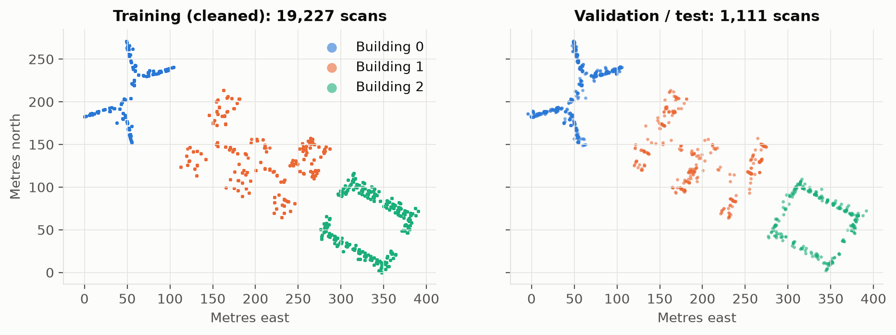
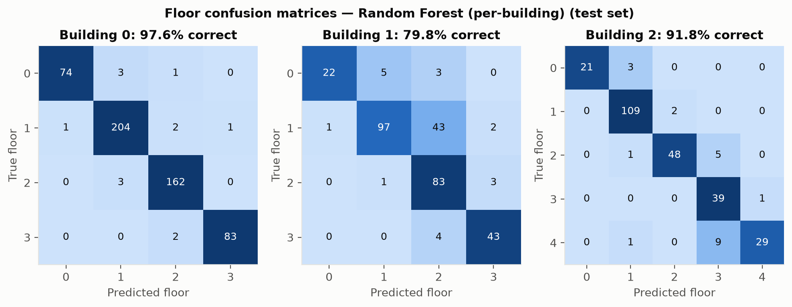
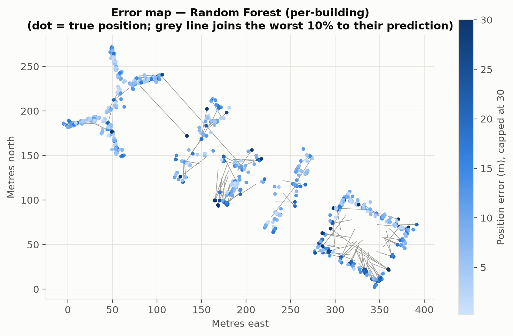

# Indoor Location Prediction Using Wi-Fi Signals

Advanced Machine Learning, Project 9, Phase 1 (Section D)

We predict which building, which floor and which (x, y) position a phone is at, using only the
Wi-Fi signal strengths it measures. Dataset: [UJIIndoorLoc](https://archive.ics.uci.edu/dataset/310/ujiindoorloc)
(3 buildings, 13 floors in total, 520 access points, 21,048 scans).



## Team

| Name | Roll no. | Contribution |
|---|---|---|
| Rishi Raj | 2401010380 | Literature review, problem framing, metrics |
| Aditya Samadhiya | 2401010037 | Data cleaning and exploratory analysis |
| Yash Yadav | 2401010515 | Feature engineering and feature comparison |
| Kaustubh Ranjan Mishra | 2401020116 | Linear/Logistic, k-NN, cross-validation design |
| Yash Raj | 2401010514 | Random Forest, error analysis, repository and report |

## Results (official test set, 1,111 scans)

| Model | Building acc. | Floor acc. | Mean error | Median error | IPIN score |
|---|---|---|---|---|---|
| Linear + Logistic Regression | **100.0%** | 88.7% | 51.99 m | 37.53 m | 52.45 |
| k-NN (k = 5) | 99.7% | 90.1% | **8.69 m** | **5.36 m** | **9.22** |
| Random Forest | 99.8% | 90.9% | 10.22 m | 7.63 m | 10.68 |
| Random Forest (per-building) | 99.8% | **91.3%** | 9.37 m | 7.07 m | 9.81 |

*IPIN score = position error + 50 m per wrong building + 4 m per wrong floor (lower is better).*

### Main findings

- Building is easy: most access points are heard in only one building.
- Floor is the hard part. Mistakes are almost always between neighbouring floors, mostly between floors 1 and 2 in building 1.
- Linear regression cannot place the phone (52 m error) because signal strength is not a linear function of position. Random Forest and k-NN work much better.
- Training a separate floor and position model for each building (per-building RF) works better than one global forest (9.37 m vs 10.22 m).
- k-NN and the per-building Random Forest are close. k-NN did better in cross-validation, but the forest got the best floor accuracy on the test set.

| Floor confusion (per-building RF) | Error map |
|---|---|
|  |  |

## What we did

1. Cleaning: we removed 637 duplicate rows and 73 scans with no access point heard (training set only; the test set is untouched).
2. EDA: 96.5% of readings are "not heard", a scan hears about 18 of 520 access points, most access points belong to one building, the test set comes from 4 months later with mostly new phones, and phone 19 gives faulty readings. See `results/figures/eda_*.png`.
3. Missing values: the dataset stores "not heard" as +100. A model would read that as the strongest possible signal. We replace it with -105 dBm, just below the weakest real reading. The value is learned from training data only.
4. Feature comparison: we tried raw dBm vs shifted vs "powed" vs heard/not-heard flags vs per-scan summary features. Cross-validation picked the simplest version (raw).
5. Models: Linear + Logistic Regression, k-NN, Random Forest (plain and per-building).
6. Validation: we used 5-fold GroupKFold by user on the training set for every choice (features, k, max_features). The official validation file is used only once, as the test set.
7. Error analysis: error split by building/floor correctness, floor confusion matrices, error maps, error per phone, error vs number of access points heard, feature importance, outlier check.

## Repository layout

```
data/                 not stored in the repo; see data/README.md to download and build it
src/indoorloc/        data.py, features.py, models.py, metrics.py, plotting.py
scripts/              download_data.py, make_processed_data.py, run_eda.py, run_experiments.py, make_tables.py
notebooks/            phase1_ml_baseline.ipynb   (full walkthrough with all EDA, CV and plots)
results/              CSV/JSON results and figures/
report/               IEEE LaTeX report (main.tex and main.pdf)
docs/                 data_dictionary.md, cleaning_log.md, literature_review.md, theory.md
```

## How to run

```bash
python3 -m venv .venv && source .venv/bin/activate
pip install -r requirements.txt
python scripts/download_data.py      # fetch UJIIndoorLoc into data/raw/
python scripts/make_processed_data.py # cleaned and model-ready files in data/processed/
jupyter notebook notebooks/phase1_ml_baseline.ipynb   # whole project step by step
python scripts/run_eda.py            # EDA figures, about 1 min
python scripts/run_experiments.py    # all experiments and figures, about 25 min
python scripts/make_tables.py        # LaTeX tables for the report
cd report && tectonic main.tex       # build the PDF (or upload the folder to Overleaf)
```

All randomness is seeded (`random_state=42`).

## Phase 2 (next)

In Phase 2 we will build a multitask neural network with one shared trunk and three output heads (building classification, floor classification, and position regression).

Planned work:
- Shared dense layers (trunk) followed by task-specific heads.
- Weighted loss combining cross-entropy (building, floor) and MSE (position).
- Compare against the Phase 1 baselines using the **same** GroupKFold split and IPIN score.
- Explore dropout and batch normalisation for regularisation.
- Optionally fine-tune with buildings as separate subnetworks (mirroring the per-building RF strategy).

## References

See [`docs/literature_review.md`](docs/literature_review.md). Main sources: Torres-Sospedra et al., *UJIIndoorLoc* (IPIN 2014);
Breiman, *Random Forests* (2001); Caruana, *Multitask Learning* (1997).

## Acknowledgements

We thank the UJIIndoorLoc authors for making their dataset publicly available on the UCI Machine Learning Repository.
This project was completed as part of the Advanced Machine Learning course (Section D, 2024–25).

## FAQ

**Q: The notebook fails with `ModuleNotFoundError: indoorloc`.**  
A: Make sure you have activated the virtual environment (`source .venv/bin/activate`) and installed the requirements (`pip install -r requirements.txt`).  
If the error persists, add the `src/` directory to your Python path: `export PYTHONPATH=src` (or `set PYTHONPATH=src` on Windows).

**Q: `run_experiments.py` takes very long — can I speed it up?**  
A: The script runs 5-fold cross-validation for all model configurations.  You can reduce `N_JOBS` or comment out individual model blocks while exploring.

**Q: The figures are missing from the notebook output.**  
A: Run `python scripts/run_eda.py` and `python scripts/run_experiments.py` first to generate the figures in `results/figures/`.

**Q: How do I build the PDF report?**  
A: Install [Tectonic](https://tectonic-typesetting.github.io) and run `cd report && tectonic main.tex`.  Alternatively, upload the `report/` folder to [Overleaf](https://www.overleaf.com).

For more details see [`docs/setup_notes.md`](docs/setup_notes.md) and [`CONTRIBUTING.md`](CONTRIBUTING.md).

