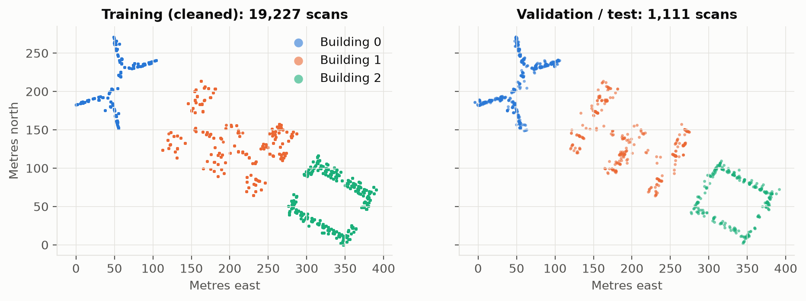
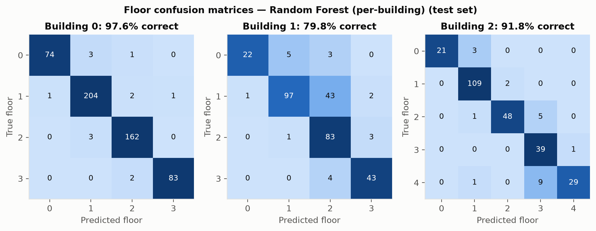
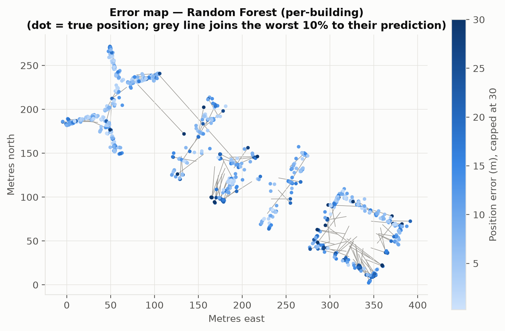
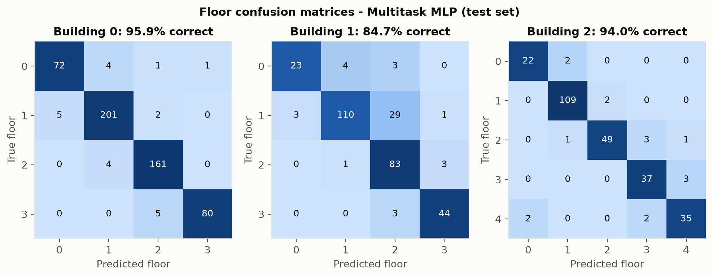
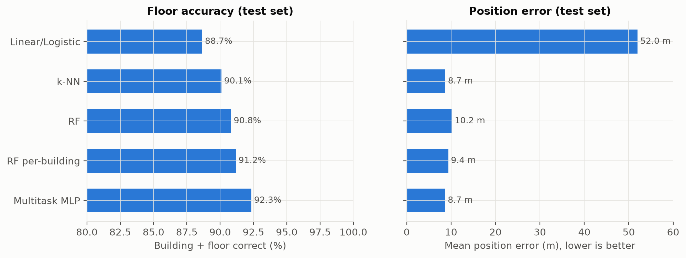

# Indoor Location Prediction Using Wi-Fi Signals

Advanced Machine Learning, Project 9 (Section D, Team T108)

We predict which building, which floor and which (x, y) position a phone is at, using only the
Wi-Fi signal strengths it measures. Dataset: [UJIIndoorLoc](https://archive.ics.uci.edu/dataset/310/ujiindoorloc)
(3 buildings, 13 floors in total, 520 access points, 21,048 scans).



## Team

| Name | Roll no. | Phase 1 | Phase 2 |
|---|---|---|---|
| Rishi Raj | 2401010380 | Linear/Logistic, k-NN, cross-validation design | Network architecture, training, final settings, notebook, review and merging |
| Aditya Samadhiya | 2401010037 | Random Forest, error analysis, repository and report | Ablation studies, hybrid models |
| Yash Yadav | 2401010515 | Feature engineering and feature comparison | Input scaling and regularisation sweep |
| Kaustubh Ranjan Mishra | 2401020116 | Literature review, problem framing, metrics | DL literature review, theory notes, report sections I to IV |
| Yash Raj | 2401010514 | Data cleaning and exploratory analysis | Final test run, error analysis and comparison figures |

The two phases are in this one repository. Phase 1 (classical machine learning) is described first, then Phase 2 (the multitask neural network).

## Phase 1 results (official test set, 1,111 scans)

| Model | Building acc. | Floor acc. | Mean error | Median error |
|---|---|---|---|---|
| Linear + Logistic Regression | **100.0%** | 88.7% | 51.99 m | 37.53 m |
| k-NN (k = 5) | 99.7% | 90.1% | **8.69 m** | **5.36 m** |
| Random Forest | 99.8% | 90.9% | 10.22 m | 7.63 m |
| Random Forest (per-building) | 99.8% | **91.3%** | 9.37 m | 7.07 m |


### Phase 1 findings

- Building is easy: most access points are heard in only one building.
- Floor is the hard part. Mistakes are almost always between neighbouring floors, mostly between floors 1 and 2 in building 1.
- Linear regression cannot place the phone (52 m error) because signal strength is not a linear function of position. Random Forest and k-NN work much better.
- Training a separate floor and position model for each building (per-building RF) works better than one global forest (9.37 m vs 10.22 m).
- k-NN and the per-building Random Forest are close. k-NN did better in cross-validation, but the forest got the best floor accuracy on the test set.

| Floor confusion (per-building RF) | Error map |
|---|---|
|  |  |

## What we did in Phase 1

1. Cleaning: we removed 637 duplicate rows and 73 scans with no access point heard (training set only; the test set is untouched).
2. EDA: 96.5% of readings are "not heard", a scan hears about 18 of 520 access points, most access points belong to one building, the test set comes from 4 months later with mostly new phones, and phone 19 gives faulty readings. See `results/figures/eda_*.png`.
3. Missing values: the dataset stores "not heard" as +100. A model would read that as the strongest possible signal. We replace it with -105 dBm, just below the weakest real reading. The value is learned from training data only.
4. Feature comparison: we tried raw dBm vs shifted vs "powed" vs heard/not-heard flags vs per-scan summary features. Cross-validation picked the simplest version (raw).
5. Models: Linear + Logistic Regression, k-NN, Random Forest (plain and per-building).
6. Validation: we used 5-fold GroupKFold by user on the training set for every choice (features, k, max_features). The official validation file is used only once, as the test set.
7. Error analysis: error split by building/floor correctness, floor confusion matrices, error maps, error per phone, error vs number of access points heard, feature importance, outlier check.

## Phase 2: one network for all three targets

Phase 1 trained a separate model for each target. Phase 2 trains one network with a shared trunk of
fully connected layers (1024, 512, 256 units, ReLU, dropout 0.3) and three output heads: building
(3 classes), floor (5 classes) and coordinates (2 numbers). The loss is
cross-entropy(building) + cross-entropy(floor) + 20 x MSE(scaled coordinates), trained with Adam,
weight decay 1e-4, batch 256 and early stopping (patience 30 on a random 10% of the training scans).
Every setting was chosen by the same 5-fold cross-validation by user as Phase 1; the official test
file was used once at the end. The code is in `src/indoorloc/deep.py`; the design notes with every
experiment are in `docs/dl_architecture.md`.

### Phase 2 results (official test set)

| Model | Building acc. | Floor acc. | Mean error | Median error | p95 error |
|---|---|---|---|---|---|
| k-NN (best Phase 1 on position) | 99.7% | 90.1% | 8.69 m | **5.35 m** | 26.99 m |
| Random Forest (per-building, best Phase 1 on floor) | 99.8% | 91.3% | 9.37 m | 7.07 m | 23.31 m |
| Multitask MLP (Phase 2) | **100.0%** | **92.3%** | **8.66 m** | 6.88 m | **20.77 m** |

In cross-validation by user, where the comparison is strict, the network leads more clearly:
83.1% floor accuracy and 11.17 m, against 74.1% and 11.78 m for k-NN and 71.3% and 13.55 m for the
per-building forest.

| Floor confusion (multitask MLP) | Phase 1 vs Phase 2 |
|---|---|
|  |  |

### Phase 2 findings

- The network is the best model on building, floor and the error tail (p95). On mean error it ties k-NN (8.66 m vs 8.69 m); k-NN keeps the lowest median. The largest gain is building 1, where floor accuracy rises from 79.8% to 84.7%.
- Two things made the network work: the coordinate loss needs a high weight (20), or the two classification losses dominate and the position head is under-trained; and early stopping must be judged on a random sample of training scans, not on one or two held-out users, whose validation loss is too noisy to stop on.
- Regularisation (`docs/dl_regularisation.md`): min-max scaling is far better than standardising for this network (11.2 m against 20.5 m and worse); dropout and weight decay help most together (12.40 m with neither, 11.17 m with both). The default settings survived the sweep.
- Ablations (`docs/dl_ablations.md`): the shared trunk beats three single-task networks on position (11.08 m vs 11.50 m), ties on floor and loses 1.8 points on building; a 256-unit trunk is far too small (15.9 m); a 100-epoch cap costs 0.5 m.
- Hybrids (`docs/hybrid.md`): feeding the trunk features into per-building forests (Hybrid A) ties the network in cross-validation (11.05 m vs 11.08 m) although it is the best model on the test file (7.75 m). Under the project rule a hybrid counts only if it clearly beats both parts in cross-validation, so we do not claim it. Splitting the targets between the two models (Hybrid B) adds nothing.
- Errors still depend on the phone (6.7 m on the best test phone, 15.2 m on the worst), as in Phase 1.

## Repository layout

```
data/                 not stored in the repo; see data/README.md to download and build it
src/indoorloc/        data.py, features.py, models.py, metrics.py, plotting.py   (Phase 1)
                      deep.py, deep_data.py, validation.py                      (Phase 2)
scripts/              Phase 1: download_data.py, make_processed_data.py, run_eda.py, run_experiments.py, make_tables.py
                      Phase 2: tune_network.py, compare_architectures.py, run_dl_regularisation.py,
                               run_dl_ablations.py, run_hybrid.py, run_dl_analysis.py
notebooks/            phase1_ml_baseline.ipynb, phase2_deep_learning.ipynb   (both executed, all plots drawn by code)
results/              CSV/JSON results (dl_*.csv, hybrid.csv, dl_best.json for Phase 2) and figures/
report/               IEEE LaTeX reports: main.tex (Phase 1), phase2.tex (Phase 2), refs.bib
docs/                 Phase 1: data_dictionary, cleaning_log, literature_review, theory
                      Phase 2: dl_architecture, dl_regularisation, dl_ablations, hybrid, dl_results,
                               dl_literature_review, dl_theory
```

## How to run

```bash
python3 -m venv .venv && source .venv/bin/activate
pip install -r requirements.txt
python scripts/download_data.py        # fetch UJIIndoorLoc into data/raw/
python scripts/make_processed_data.py  # cleaned and model-ready files in data/processed/

# Phase 1
jupyter notebook notebooks/phase1_ml_baseline.ipynb   # whole of Phase 1 step by step
python scripts/run_eda.py              # EDA figures, about 1 min
python scripts/run_experiments.py      # all Phase 1 experiments and figures, about 25 min
python scripts/make_tables.py          # LaTeX tables for the Phase 1 report

# Phase 2 (each script is a cross-validated experiment; times are for a laptop CPU)
python scripts/tune_network.py             # loss weight and patience sweep, about 1 h
python scripts/compare_architectures.py    # trunk size, batch norm, Huber loss, about 40 min
python scripts/run_dl_regularisation.py    # scaling, dropout, weight decay, about 80 min
python scripts/run_dl_ablations.py         # ablation studies, about 45 min
python scripts/run_hybrid.py               # hybrid models, about 20 min
python scripts/run_dl_analysis.py          # final test run and all Phase 2 figures, about 5 min
jupyter notebook notebooks/phase2_deep_learning.ipynb  # Phase 2 step by step, reads the results above

cd report && tectonic main.tex && tectonic phase2.tex  # build the PDFs (or upload the folder to Overleaf)
```

All randomness is seeded (`random_state=42` and `torch.manual_seed(42)`). Results from the neural
network can differ in the second decimal between machines (floating point); the design notes say where.

## References

See [`docs/literature_review.md`](docs/literature_review.md) (Phase 1) and [`docs/dl_literature_review.md`](docs/dl_literature_review.md) (Phase 2). Main sources: Torres-Sospedra et al., *UJIIndoorLoc* (IPIN 2014);
Breiman, *Random Forests* (2001); Caruana, *Multitask Learning* (1997); Srivastava et al., *Dropout* (2014); Kingma and Ba, *Adam* (2015).

## Acknowledgements

We thank the UJIIndoorLoc authors for making their dataset publicly available on the UCI Machine Learning Repository.
This project was completed as part of the Advanced Machine Learning course (Section D, 2026).

## FAQ

**Q: The notebook fails with `ModuleNotFoundError: indoorloc`.**  
A: Make sure you have activated the virtual environment (`source .venv/bin/activate`) and installed the requirements (`pip install -r requirements.txt`).  
If the error persists, add the `src/` directory to your Python path: `export PYTHONPATH=src` (or `set PYTHONPATH=src` on Windows).

**Q: The experiment scripts take long. Can I speed them up?**  
A: Every script runs 5-fold cross-validation for each setting. While exploring you can comment out individual model blocks; the Phase 2 sweeps also append each finished row to their CSV, so a stopped run can be resumed.

**Q: The figures are missing from the notebook output.**  
A: Both notebooks draw their own figures. The scripts write the versions used in the reports to `results/figures/`.

**Q: How do I build the PDF report?**  
A: Install [Tectonic](https://tectonic-typesetting.github.io) and run `cd report && tectonic main.tex` (Phase 1) or `tectonic phase2.tex` (Phase 2).  Alternatively, upload the `report/` folder to [Overleaf](https://www.overleaf.com).

For more details see [`docs/setup_notes.md`](docs/setup_notes.md) and [`CONTRIBUTING.md`](CONTRIBUTING.md).

